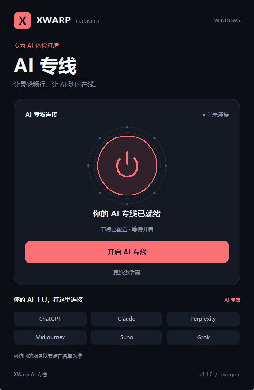

# XWarp AI 专线

XWarp Connect 是面向 Windows 的 XWarp 客户端。输入服务端提供的 `XWARP://...` KEY 后，通过一个开关控制连接和 Windows 系统代理。

深色界面突出 AI 专线：圆形电源开关、清晰的启停状态，以及 ChatGPT、Claude、Perplexity 等 AI 服务卡片。支持粘贴激活码和回车激活。



## 下载与使用

在 [Releases](https://github.com/howellxuKing/xwarp-client/releases) 下载 Windows x64 ZIP，解压到可写目录，运行 `XWarp.exe`，粘贴 KEY 后开启专线。

请保留同目录中的 `xwarp-core.exe`、`_internal` 和其他文件。当前版本是免安装的目录式应用，不是单文件程序。

客户端使用 Hysteria 2 核心，监听本机 HTTP 代理 `127.0.0.1:10809` 和 SOCKS5 代理 `127.0.0.1:10808`。开关控制 Windows 系统代理；具体应用是否使用代理取决于应用自身设置。客户端为部分国内域名配置代理绕过项，海外 AI 的访问范围由服务端规则控制。

KEY 和节点配置保存在本地。请勿公开或上传自己的 `config.json`、`xwarp_client.yaml` 或 KEY。

## 从源码运行

需要 Windows 和 Python 3.12。安装依赖：

```powershell
python -m pip install -r requirements.txt
```

将兼容的 Windows x64 Hysteria 2 核心放在源码目录中并命名为 `xwarp-core.exe`，然后运行：

```powershell
python main.py
```

Hysteria 核心来自 [apernet/hysteria](https://github.com/apernet/hysteria)，第三方组件遵循各自的许可证。

## 打包

```powershell
python -m pip install -r requirements-build.txt
python -m PyInstaller --noconfirm XWarp.spec
Copy-Item xwarp-core.exe dist/XWarp/xwarp-core.exe
```

发布时将 `dist/XWarp` 的完整内容压缩为 ZIP。不要加入激活后生成的配置文件。

## 项目结构

- `main.py`：界面、KEY 解析、核心进程和系统代理控制。
- `client_ui.py`：AI 专线界面和状态展示。
- `XWarp.spec`：PyInstaller 打包配置。
- `logo.png`：客户端 Logo。

服务端独立部署和维护，通过 KEY 与客户端衔接。该公开仓库仅包含客户端代码和客户端发布包。
